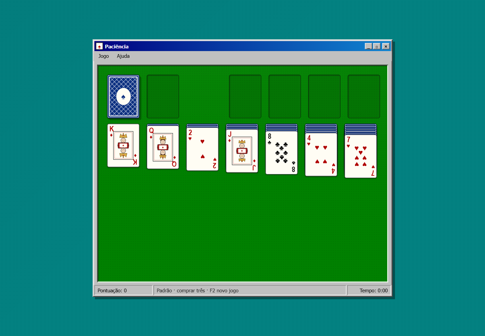
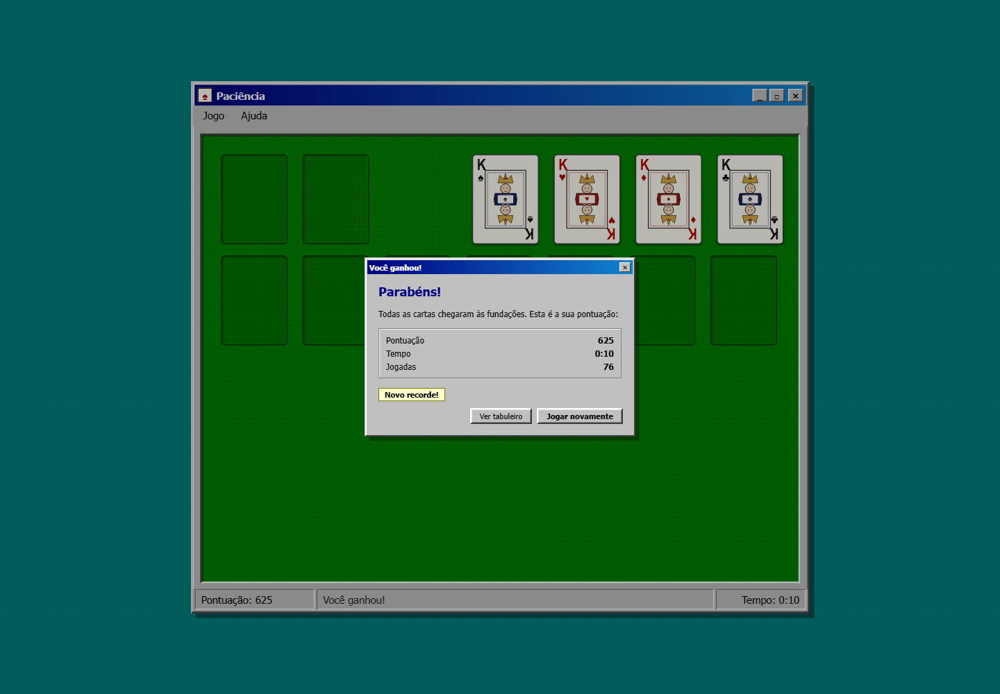
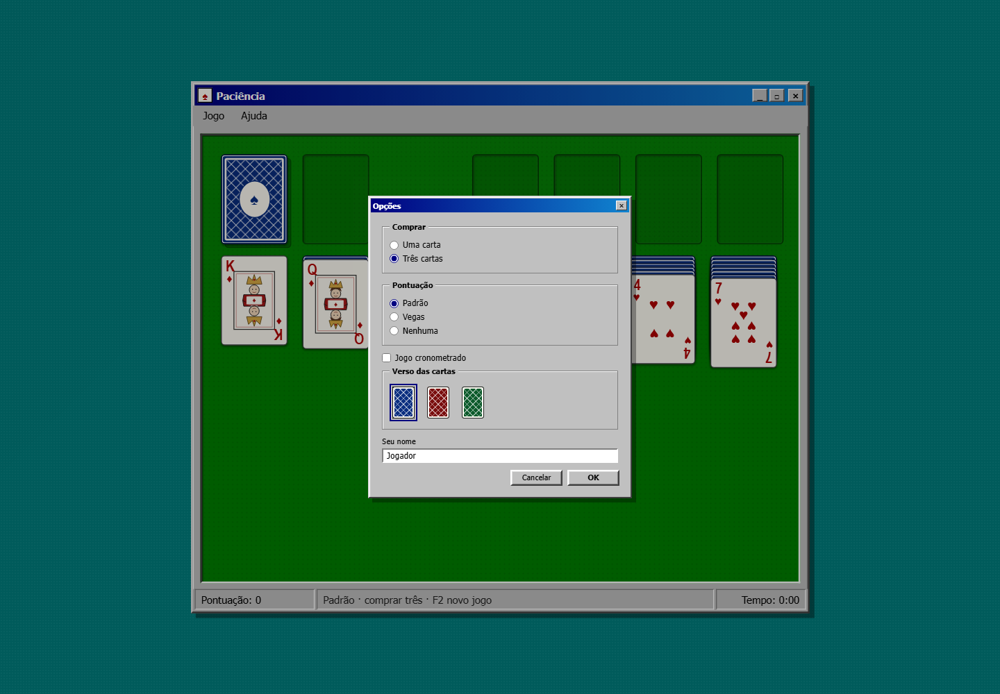

# Paciência 95

Uma recriação do clássico **Paciência (Klondike) do Windows 95**, com frontend em
**React + Vite** e backend em **Rust + Axum + SQLite**.

O jogo roda no navegador com resposta imediata, mas o backend tem papel de
verdade: cria a distribuição, salva o progresso, valida a sequência de jogadas
por replay, calcula a pontuação oficial e mantém recordes e estatísticas.



| Vitória | Opções |
| --- | --- |
|  |  |

## Recursos

- Klondike completo: 7 colunas, 4 fundações, monte e descarte.
- Compra de **uma** ou **três** cartas, com reciclagem do descarte.
- Arrastar e soltar com a pilha inteira, duplo clique para enviar à fundação e
  virada automática de cartas expostas.
- Pontuação padrão, Vegas ou desativada; jogo cronometrado opcional.
- Interface inspirada no Windows 95: janela, menus, barra de status, bevels,
  cartas e versos desenhados em SVG/CSS.
- Animação de vitória com cartas quicando e deixando rastro.
- Salvamento automático, retomada de partida, recordes e estatísticas.
- Modo offline: se o backend estiver indisponível, o jogo continua com
  salvamento em `localStorage`.

## Stack

| Camada | Tecnologia |
| --- | --- |
| Frontend | React 19, Vite 8, JavaScript, CSS |
| Backend | Rust, Axum, Tokio |
| Persistência | SQLite via SQLx |
| Testes | Vitest, testes Rust, Playwright (verificação de UI) |

## Como rodar

Pré-requisitos:

- Node.js 20 ou superior e npm.
- Rust stable e Cargo.
- No Windows, um linker C instalado (Visual Studio Build Tools com “Desktop
  development with C++”), necessário para compilar o SQLite.

Instale as dependências:

```bash
npm install
npm install --prefix frontend
```

Modo desenvolvimento (Vite + backend juntos):

```bash
npm run dev
```

Abra **http://localhost:5173**. O Vite faz proxy de `/api` para o backend em
`http://127.0.0.1:3001`.

Build de produção (servidor local):

```bash
npm run build
npm start
```

O build gera o frontend em `frontend/dist` e o binário Rust em
`backend/target/release`. No release, o frontend é **embutido no executável** e
o Axum serve a interface e a API no mesmo endereço. `npm start` abre o navegador
automaticamente; use `npm run start:no-open` para apenas iniciar o servidor.

## Distribuição Windows (portátil)

O comando abaixo gera um pacote x64 que **não exige Node, Rust nem instalação**:

```bash
npm run dist:windows
```

Saídas:

- `dist/Paciencia95/` — pasta pronta para copiar.
- `dist/Paciencia95-windows-x64.zip` — pacote para enviar ao usuário.

Para jogar, basta extrair o zip e executar **`Paciencia95.exe`**. O navegador
padrão abre o jogo; a janela do console deve continuar aberta enquanto o
servidor local estiver rodando. Para encerrar, feche o console ou pressione
`Ctrl+C`.

O pacote é **portátil**: os dados ficam em `dados\paciencia.db` ao lado do
executável. Se a pasta for somente leitura (por exemplo, `Program Files`), o
jogo usa `%LOCALAPPDATA%\Paciencia95\paciencia.db`. Para começar do zero, feche
o jogo e apague o `paciencia.db`.

O executável não é assinado digitalmente; o Windows SmartScreen pode pedir
confirmação (“Mais informações” → “Executar assim mesmo”). O jogo escuta apenas
em `127.0.0.1`, não envia dados para a internet e não requer firewall.

## Distribuição Desktop Nativa (Tauri 2.0 — Windows e Linux)

O projeto conta com suporte nativo a desktop via **Tauri 2.0**:
- **Janela nativa real** sem navegador aberto e sem janela de console no Windows (`#windows_subsystem = "windows"`).
- **Comunicação direta via IPC** (sem portas de rede TCP abertas e sem risco de firewall/antivírus).
- **SQLite local** gerenciado nativamente na pasta de dados do aplicativo (`app_data_dir`).
- **Botões da moldura do Windows 95** integrados para minimizar, maximizar e fechar a janela do sistema operacional.

Comandos:

```bash
# Desenvolvimento desktop com hot-reload:
npm run dev:tauri

# Gerar instaladores (.msi / .exe no Windows, .deb / .AppImage no Linux):
npm run build:tauri
```

### Variáveis de ambiente

| Variável | Padrão | Descrição |
| --- | --- | --- |
| `PORT` | `3001` | Porta local; `0` escolhe uma porta livre |
| `HOST` | `127.0.0.1` | Interface de escuta |
| `DATABASE_PATH` | depende do modo | Caminho completo do arquivo SQLite |
| `PACIENTIA_DATA_DIR` | depende do modo | Pasta que guarda `paciencia.db` |
| `FRONTEND_DIST` | `frontend/dist` | Pasta servida no modo dev |
| `PACIENTIA_NO_OPEN` | — | Equivale a `--no-open` |

No modo dev, o banco fica em `data/paciencia.db`. No release comum (`npm start`),
fica em `%LOCALAPPDATA%\Paciencia95\paciencia.db`; no pacote portátil, em
`dados\paciencia.db` ao lado do executável.

## Testes

```bash
npm test          # Vitest + testes Rust
npm run lint      # oxlint
```

Os testes cobrem baralho, distribuição, movimentos válidos, pontuação, vitória,
replay no Rust e endpoints da API. A pasta `shared/fixtures/` guarda uma
distribuição solucionável usada para validar o fluxo completo de vitória.

Verificações de navegador (opcional, com o servidor em `:3001` e Chrome
instalado):

```bash
node tools/verify-ui.mjs
node tools/verify-engine.mjs
node tools/verify-win-ui.mjs <id-da-partida>
```

Os scripts de verificação são ferramentas de desenvolvimento e não fazem parte
do bundle entregue ao navegador.

## Regras e pontuação

- As colunas são montadas em ordem decrescente, alternando vermelho e preto.
- Só um Rei pode ocupar uma coluna vazia.
- As fundações sobem de Ás a Rei, por naipe.
- O monte compra uma ou três cartas; o descarte pode ser reciclado.
- A partida termina quando as quatro fundações chegam ao Rei.

Pontuação padrão:

| Ação | Pontos |
| --- | --- |
| Carta para a fundação | +10 |
| Carta do descarte para uma coluna | +5 |
| Carta do tableau virada para cima | +5 |
| Carta da fundação de volta ao tableau | −15 |
| Reciclar o descarte (comprar três) | −100 |
| Reciclar o descarte (comprar uma) | −20 |
| Bônus de vitória cronometrada | 700.000 ÷ segundos (acima de 30 s) |

No modo **Vegas**, a partida começa com −$52 e cada carta na fundação vale $5,
sem bônus de tempo. No modo **Nenhuma**, a pontuação fica zerada.

## API

| Método | Rota | Função |
| --- | --- | --- |
| `GET` | `/api/health` | Health check |
| `POST` | `/api/games` | Cria partida, embaralha e devolve o estado inicial |
| `GET` | `/api/games/latest` | Última partida em andamento (ou 204) |
| `GET` | `/api/games/{id}` | Carrega uma partida |
| `PUT` | `/api/games/{id}` | Salva jogadas e tempo decorrido |
| `POST` | `/api/games/{id}/finish` | Valida a vitória por replay e grava o recorde |
| `GET` | `/api/scores` | Ranking das melhores pontuações |
| `GET` | `/api/stats` | Partidas, vitórias, aproveitamento e melhores tempos |

O backend guarda o baralho embaralhado e reexecuta a lista de jogadas com o mesmo
motor de regras em Rust antes de aceitar um resultado. Assim, a pontuação não é
apenas confiada ao cliente.

## Estrutura

```
paciencia-95/
├─ backend/
│  ├─ migrations/0001_init.sql
│  ├─ build.rs             # invalida o embed quando o Vite muda
│  └─ src/
│     ├─ api.rs            # rotas Axum
│     ├─ db.rs             # SQLite/SQLx
│     ├─ main.rs           # servidor, porta, navegador e dados
│     ├─ static_files.rs   # frontend em disco (dev) ou embutido (release)
│     └─ engine/           # cartas, regras, replay, pontuação
├─ frontend/
│  └─ src/
│     ├─ api/client.js
│     ├─ components/       # janela, tabuleiro, cartas, diálogos, animação
│     ├─ game/             # motor de regras e estado da partida
│     ├─ hooks/
│     └─ styles/
├─ shared/fixtures/        # distribuição solucionável compartilhada
├─ tools/                  # verificação, empacotamento e LEIA-ME do zip
├─ data/                   # banco SQLite do modo dev
└─ dist/                   # pacote Windows gerado por npm run dist:windows
```

## Decisões de projeto

- **Regras no cliente, validação no servidor.** O frontend mantém a jogabilidade
  instantânea; o backend reexecuta as jogadas para validar a vitória e a
  pontuação.
- **Sem assets da Microsoft.** Cartas, naipes, versos e a janela foram recriados
  com SVG, CSS e fontes do sistema, inspirados na estética de 1995.
- **Sem desfazer ou dicas**, preservando o comportamento do Klondike clássico.
- **Single-player local.** Não há login, multiplayer ou sincronização entre
  dispositivos.
- O aviso de retomada e o painel de estatísticas são extensões modernas; a mesa,
  as regras e os menus seguem o original.

## Solução de problemas

- **Porta ocupada:** no release, o jogo tenta uma porta livre automaticamente;
  no dev, altere `PORT` e o proxy em `frontend/vite.config.js`.
- **Backend indisponível:** o jogo abre em modo local e mostra o aviso na barra
  de status; os recordes locais ficam em `localStorage`.
- **Erro D8050 do MSVC ao compilar SQLite:** o projeto já usa `debug = 0` nos
  perfis `dev` e `test` para evitar esse problema em instalações recentes do
  Visual Studio. Se ainda ocorrer, atualize o Visual Studio Build Tools.
- **Resetar o banco no dev:** pare o backend e apague `data/paciencia.db` (e os
  arquivos `-wal`/`-shm`).
- **Resetar o banco da distribuição:** feche o `Paciencia95.exe` e apague
  `dados\paciencia.db` na pasta extraída (ou o arquivo em
  `%LOCALAPPDATA%\Paciencia95`).
- **Console fecha sozinho:** execute o `.exe` a partir de uma pasta local, não
  de dentro do zip; extraia o pacote antes.

## Referências de pesquisa

- [Microsoft KB 101766 — Highest Score in Windows Solitaire](https://web.archive.org/web/20121021174637/http://support.microsoft.com/kb/101766/en-us)
- [Microsoft Solitaire — Wikipedia](https://en.wikipedia.org/wiki/Microsoft_Solitaire)

## Créditos

Inspirado no Microsoft Solitaire original de Wes Cherry e Susan Kare. Este é um
projeto independente, sem código, imagens ou marca da Microsoft.
